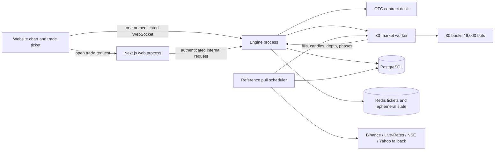

# OTC order-book integration plan

Status: implementation plan only. No production behavior changes are included
in this document.

## Intended result

Replace the website's CFD trading path with the verified 30-market OTC
order-book simulation. Keep the existing website login, accounts, demo balance,
history and WebSocket infrastructure. The engine will run 30 independent order
books with 200 background bots each, pull infrequent external reference prices
on the server, and publish candles made only by matched orders.

The owner will create ordinary accounts through the website's normal signup
flow and use them as **Tobs**. They are not seeded, specially marked or given a
different login path. A controlled crowd of 1, 10, 20, 40 or 100 of those
accounts can then place simultaneous DEMO trades. Tobs are separate from the
6,000 internal market bots.

The OTC contract remains:

- fixed expiry;
- 92% profit on a win (a ₹100 stake returns ₹192 total);
- optional stop-loss and take-profit price levels;
- stop-loss loses the full stake;
- take-profit pays the same fixed ₹192 total for a ₹100 stake;
- no manual close;
- if no SL/TP is reached, expiry decides Up or Down from the actual displayed
  execution price; an exact tie refunds the stake;
- the first matching execution to reach SL or TP wins. Sequential executions,
  rather than candle OHLC, remove ambiguity if both levels appear inside one
  candle.

## Target architecture

The order-book worker owns price discovery. The main engine owns authenticated
commands, stake accounting, durable trade records, settlement and WebSocket
fan-out. The browser never calls a public price provider.

## Phase 1: establish one market definition

1. Create `packages/market-sim` in the main repository from the verified
   prototype implementation. Move the order book, anchored market, deterministic
   random state, bot profiles and conservation tests with it.
2. Expand `packages/db/src/catalogue.ts` from the current 19 markets to the same
   30 markets used by the prototype:
   - Crypto: BTC, ETH, BNB, SOL, XRP, DOGE, ADA, LTC, LINK and DOT against USDT.
   - Forex: EUR/USD, GBP/USD, USD/JPY, USD/CHF, AUD/USD, USD/CAD, NZD/USD,
     EUR/GBP, EUR/JPY and GBP/JPY.
   - India: NIFTY 50, BANK NIFTY, FINNIFTY, NIFTY IT, NIFTY MIDCAP 100 and
     SENSEX.
   - Commodities: gold, silver, WTI futures and Brent futures.
3. Give the catalogue all data needed by the database, engine and UI: symbol,
   name, class, precision, tick size, movement calibration, reference provider,
   provider symbol, session policy and stake-to-flow-lot scale.
4. Make this shared catalogue the only source for seeding assets and displaying
   markets. Add a test that fails on duplicate symbols, missing feed mappings or
   inconsistent precision.
5. Add `packages/market-sim` to the workspace and production Docker image.

This phase removes the current split where the website knows 19 markets while
the lab knows 30.

## Phase 2: production reference-price puller

Run one scheduler inside the engine; never pull once per browser or once per
bot. Pull once per provider group and distribute the accepted quote to the
relevant market worker.

| Market group | Server-side source | Normal interval |
| --- | --- | ---: |
| 10 crypto pairs | Binance public batch ticker | 60 seconds |
| 10 FX pairs and gold/silver | Live-Rates public snapshot | 5 minutes |
| Five NSE indices | NSE `allIndices` snapshot | 15 minutes |
| SENSEX and missing index fallback | Yahoo chart snapshot | 15 minutes |
| WTI and Brent futures | Yahoo chart snapshot | 5 minutes |

For every response:

1. enforce a short timeout and a response-size limit;
2. reject non-numeric, non-positive, future-dated or older-than-current quotes;
3. save price, provider, provider timestamp, receipt timestamp, quote type and
   session status;
4. retain the last good quote across timeouts, rate limits and restarts;
5. mark its age as fresh, delayed, stale, closed-last-quote or unavailable;
6. double the next interval after provider failure and add jitter so restarts do
   not cause bursts;
7. send the accepted reference to the order-book worker as an input. A reference
   update influences future bot decisions and never writes a candle directly.

Add a `MarketReference` database table for the last accepted value and a bounded
`MarketReferenceAudit` table for troubleshooting. Keep the public-provider URLs
and credentials server-side. The UI receives only source name, source time, age
and status.

The public no-key sources are suitable for this low-frequency model but have no
availability guarantee. Keep the existing FYERS and authenticated Live-Rates
adapters as later replacements without changing the order-book interface.

## Phase 3: persistent 30-market worker

1. Start one worker thread from `apps/engine`. It loads all 30 books and advances
   them on the verified six-second simulation tick whether anyone is watching.
2. Fund 200 internal bots in each book. Makers maintain finite multi-level
   liquidity; aggressive bots consume it. Only matches create last price, volume
   and candles.
3. Preserve a separate random stream for Tob orders so activating a Tob crowd
   does not secretly change the bots-only random sequence.
4. Add a monotonically increasing world generation and execution sequence.
   Every snapshot and delta carries both values so reconnecting clients can
   detect a restart or missed data.
5. Save a deterministic checkpoint approximately every 30 seconds and after a
   controlled shutdown. A checkpoint contains order-book state, participant
   wallets, bot state, random state, current candle, reference, simulation time
   and the latest processed command ID.
6. Persist closed one-minute candles and a bounded execution audit. On restart,
   restore the checkpoint and replay accepted commands after its sequence. Never
   generate a new 45-minute warm-up on every production restart.
7. Serialize user commands and checkpoint barriers. A trade command cannot be
   checkpointed as completed until its database trade intent has been finalized;
   this prevents either a duplicate fill or a missing trade after a crash.

Fast-forward stays disabled for ordinary website users and production APIs. It
is available only in local/staging test controls.

### Internal bot leaderboard

Bots remain engine-only order-book participants. Do not create `User`, `Account`,
`Session`, `Trade` or transaction-ledger rows for them.

Give each one a stable market-scoped identity such as `BTCUSDT-B042`. The worker
stores its initial equity and current wallet. Once per second, calculate:

- current equity = quote cash (free plus reserved) + all inventory (free plus
  reserved) marked at the latest matched price;
- total P&L = current equity minus initial equity;
- return percentage = total P&L divided by initial equity.

Use return percentage to rank bots across markets because raw quote values for
BTC, JPY, indices and commodities are not comparable. Display market, bot ID,
quote-currency P&L and return percentage. The selected-market view can rank by
raw P&L because every bot there shares the same quote scale.

Publish only the top 10 as a compact, once-per-second summary. Checkpoint each
bot's wallet and initial equity with the book so P&L survives a restart. This is
a new engine leaderboard message/endpoint; it must not reuse the existing
database user leaderboard or register bot accounts.

## Phase 4: map website trades to the book

Add an explicit `OTC_FIXED` trade mode rather than reusing nullable CFD fields
without a discriminator. Existing historical binary and CFD rows remain
readable.

Opening a trade:

1. The browser sends symbol, Up/Down, stake, expiry duration, optional SL/TP and
   a client-generated idempotency key.
2. The web route verifies the session and account ownership, then forwards the
   authenticated actor ID to the engine exactly as it does today.
3. In one database transaction the engine locks the DEMO account, checks status
   and balance, debits the stake, and creates a `PENDING` trade intent.
4. The worker converts stake to a bounded flow-lot size using the market's
   catalogue scale and submits an immediate-or-cancel Up/Down flow order to the
   same finite book used by the bots.
5. If nothing fills, the engine refunds the reserved stake and reports that
   liquidity was unavailable. It does not invent an entry price.
6. If it fills, volume-weighted fill price becomes `entryPrice`. Store fill
   quantity, execution sequence and market command ID, then mark the trade open.
7. Notify only after both the market result and database finalization are
   durable. Repeating the same idempotency key returns the original result.

The INR stake is the fixed-payout contract balance; the flow lots are a
calibrated representation of its order-flow pressure. They must be stored
separately so order-book inventory is never confused with rupee accounting.

Settlement runs after each market execution, in execution-sequence order:

- reaching SL settles `LOST / STOP_LOSS` and credits nothing;
- reaching TP settles `WON / TAKE_PROFIT` and credits stake plus 92% profit;
- at expiry, the last execution at or before expiry decides direction;
- an exact entry-price tie settles `REFUNDED / DURATION`;
- there is no manual-close route or button.

Reuse the existing transaction ledger and balance notifications. Remove house
governor, leverage, spread-fee, liquidation, trailing-stop and manual-close
logic from the new mode. Do not let positions, desired payouts or account
balances feed into price generation.

Database changes should include:

- `TradeMode` and `TradeIntentStatus` enums;
- trade idempotency key, market command ID, entry/settlement execution sequence,
  flow lots and fill quantity;
- `MarketReference`, `MarketReferenceAudit`, `MarketCheckpoint` and bounded
  `MarketExecution` records;
- indexes for open trades by symbol/expiry and unique command/idempotency keys.

Existing `durationSec`, `stopLoss`, `takeProfit`, `closeReason`, stake and ledger
columns can be reused once the trade mode makes their meaning unambiguous.

## Phase 5: normal signup accounts used as Tobs

Tob is a simulation label for an ordinary authenticated website user. The owner
signs up each account using the existing registration page, logs in normally and
uses its DEMO account. No `isTob` column, seeded credential or special role is
needed. When any authenticated user submits a trade, the worker tags the
corresponding flow order as `Tob` and keeps the database actor ID for the trade
audit without exposing that identity in public market tape.

Do not turn the 6,000 internal bots into users: their book wallets are engine
state and they need no email, password, session, account or database trade rows.
Do not reuse the old database `isBot` concept for these order-book bots.

The manual verification flow is:

1. sign up through the normal page;
2. log in through the normal page;
3. select the DEMO account and reset its play balance using the existing DEMO
   flow when needed;
4. select any market, place several trades and verify entries, SL/TP/expiry,
   history and balance changes;
5. repeat with the owner's other normally-created accounts.

For simultaneous crowd verification, provide a staging-only runner which reads
a local credential manifest containing accounts the owner already created. The
manifest is ignored by Git and never logged. The runner calls the normal login,
trade, history and WebSocket endpoints; it does not insert users or sessions
directly into the database.

The runner selects 1, 10, 20, 40 or 100 accounts and sends 10 trades per account.
It records account, market, direction, stake, entry time, expiry, SL/TP, fill,
outcome and chart/order-flow response. Pre-authenticate gradually under the
normal production rate limit, or raise the existing `LOGIN_IP_RL` only in an
isolated staging environment; never relax the public production limit.

All normal account features continue to work because these are normal accounts.
For this rollout, use their DEMO accounts only; LIVE funds, deposits and
withdrawals are not part of the Tob test.

## Phase 6: website integration

Keep the current React shell and Lightweight Charts component. Replace the CFD
ticket with an OTC ticket containing expiry, investment, an optional SL/TP
switch, calculated ₹92 profit per ₹100, total return and Up/Down buttons.

The website should show:

- all 30 markets grouped by Crypto, Forex, India and Commodities;
- 92% payout and OTC labels;
- reference source, source time and fresh/delayed/stale/closed status;
- TradingView-style candle colours;
- actual execution volume, selected-market order-book depth and recent tape;
- entry, SL, TP, current price and expiry lines for open trades;
- multiple simultaneous positions and their independent remaining times;
- an order-flow phase label: bots only, arriving, balanced, buy/sell pressure,
  absorption, liquidity stress or recovery;
- a top-10 bot P&L leaderboard fed from engine wallets, without bot user rows;
- the existing DEMO banner whenever a Tob is using a DEMO account.

WebSocket protocol additions:

- one initial selected-market snapshot;
- sequenced candle/volume updates and newly closed bars;
- selected-market depth/tape deltas;
- compact watchlist price/status changes for the other 29 markets;
- reference metadata updates;
- a compact top-10 bot leaderboard update no more than once per second;
- trade opened/settled and balance messages;
- worker generation and resume cursor.

Apply the chart-performance checklist:

1. call `setData` only for bootstrap, timeframe changes and bounded rollover;
   use incremental updates afterwards;
2. create watchlist/depth/tape rows once and patch their values;
3. coalesce drawing with `requestAnimationFrame`, throttle secondary updates and
   suspend hidden-tab rendering/subscriptions;
4. cache six recent markets and reject stale switch responses;
5. keep the simulation in the worker and preserve every tick;
6. expose downloadable render diagnostics and measure actual browser frame
   timing separately from DOM tests.

## Phase 7: tests and acceptance gates

### Engine correctness

- deterministic direct-versus-worker equivalence with frozen references;
- cash and inventory conservation for every book participant;
- candle volume equals the sum of actual matched quantities;
- no reference pull, unmatched order, viewer or position directly moves price;
- first-execution SL/TP ordering and exact expiry/tie settlement;
- fixed payout ledger: ₹100 loses ₹100 or returns ₹192;
- many open trades on one account and many accounts on one market;
- command idempotency and crash recovery at every pending/fill/finalize boundary;
- checkpoint/restart continuity with no price jump or duplicated candle;
- bot leaderboard P&L exactly reconciles with each engine wallet, includes
  reserved funds/inventory, and resumes unchanged from a checkpoint.

### Reference failures

- malformed, future and out-of-order quote rejection;
- timeout, 429 and provider outage keep the last good quote;
- stale/closed labels use source timestamps rather than repeated receipt times;
- all 30 mappings and provider-group intervals are verified.

### Tob end-to-end tests

Run 10 simultaneous trades per Tob for 1, 10, 20, 40 and 100 Tobs. Cover
balanced, buy-heavy, sell-heavy, burst and staggered arrival combinations. Save
the exact trade schedule, matches, phases, candles, outcomes and combined
balances. The test passes on accounting, matching, continuity and responsiveness;
it must not require Tobs to lose.

### Performance

- measure on the KVM 4 itself at normal speed with 6,000 bots, then with 100
  active Tobs;
- separately test 300× only in staging;
- record engine CPU/RAM, event-loop delay, WebSocket payloads, database latency
  and connected-client count;
- verify web/engine stay responsive while the existing Postgres and Redis
  containers run;
- on actual desktop and phone browsers target redraw p95 below 16 ms, no
  recurring tasks above 50 ms and cached market switching within one frame.

The laptop's earlier 151–152 MiB measurement suggests the KVM 4 has ample RAM,
but production capacity is accepted only after this VPS test. Browser CPU/GPU
must be reported separately from server CPU.

## Phase 8: safe rollout

1. Create a clean branch/worktree from `main`; the current working tree contains
   unrelated uncommitted CFD/UI changes and must not be overwritten.
2. Merge the simulator and reference puller behind
   `OTC_ORDER_BOOK_ENABLED=false` by default.
3. Run database migrations and seed all 30 assets without opening the feature to
   ordinary accounts.
4. Deploy a staging engine or DEMO-only mode on the KVM 4. Keep the new path
   unavailable to LIVE account trading during verification.
5. Run provider-outage, restart, 100-user crowd, long-session and browser
   performance tests. Keep the saved reports with the release.
6. Let the owner sign up and log into ordinary accounts, use them as Tobs, and
   approve the UX and trade lifecycle.
7. Enable the new OTC path for DEMO accounts first. Monitor reference age,
   worker restarts, pending intents, settlement delay, CPU, memory, DB latency
   and WebSocket backpressure.
8. After a stable observation window, remove CFD controls and routes from the
   user interface. Keep legacy trade rows readable in history.
9. Live accounts, deposits and withdrawals remain outside this rollout until a
   separate business, legal, risk and production-data review explicitly enables
   them.

## Recommended implementation order

1. Shared 30-market catalogue and package extraction.
2. Reference puller plus persistence and failure tests.
3. Persistent worker and worker/command/checkpoint protocol.
4. `OTC_FIXED` contract desk and database migration.
5. WebSocket snapshot/delta protocol.
6. Website market selector, chart, depth/tape and OTC ticket.
7. Normal-signup Tob verification and the private credential-based crowd runner.
8. Full correctness, restart, provider and performance verification.
9. DEMO-only VPS deployment and manual acceptance.

## Definition of done

The integration is complete when the owner can sign up and log in through the
normal flow, use that account as a Tob, see all 30 markets and truthful
reference status, place several fixed-
expiry trades with optional SL/TP, and observe entries and settlements against
the same order-driven chart. The top-10 internal bot P&L leaderboard must come
directly from engine wallets without registered bot users. The 100-Tob runner
must use accounts created through normal signup and the same external trade
path. All accounting and matching invariants must pass, provider failures and
engine restarts must preserve continuity, and KVM/browser measurements must be
saved before the feature is opened beyond DEMO testing.
